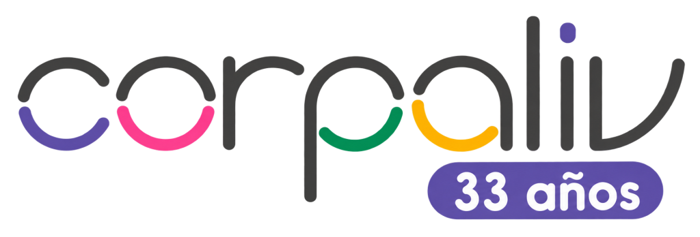

<p align="center">
  
</p>

<h1 align="center">Alba Lab</h1>

<p align="center">
  Aplicación móvil para conectar a personas y empresas con la misión de <b>CORPALIV</b> y su red sociolaboral <b>Alba Lab</b>.
</p>

<p align="center">
  
  
  
  
</p>

---

## 📑 Índice

1. [Descripción del proyecto](#-descripción-del-proyecto)
2. [Integrantes](#-integrantes)
3. [Funcionalidades implementadas](#-funcionalidades-implementadas)
4. [Tecnologías](#-tecnologías)
5. [Arquitectura y estructura](#-arquitectura-y-estructura)
6. [Pasos para ejecutar](#-pasos-para-ejecutar)
7. [Datos de prueba](#-datos-de-prueba)
8. [Trabajo colaborativo](#-trabajo-colaborativo)

---

## 📖 Descripción del proyecto

**CORPALIV** es una corporación sin fines de lucro que trabaja por el desarrollo e inclusión de personas con discapacidad múltiple, a través de la **Escuela Especial Jan Van Dijk** y su **Red Sociolaboral Alba Lab**.

Hoy falta un canal claro y centralizado para comunicar su impacto social, lo que dificulta que el interés de un potencial colaborador se convierta en una acción real (donaciones, voluntariado, alianzas, compra de productos o capacitaciones).

**Alba Lab** es una app Android que busca resolver esto:

- 💜 Da a conocer el propósito, programas e historia de la corporación.
- 🛍️ Muestra el catálogo de productos hechos por jóvenes y adultos de Alba Lab.
- 🤝 Facilita que personas y empresas manifiesten su interés en colaborar mediante un formulario.
- 👤 Permite a los socios crear una cuenta y revisar las solicitudes que han enviado.

> Proyecto desarrollado para la **Evaluación Parcial 2** de la asignatura **DSY1105 – Desarrollo de Aplicaciones Móviles** (Duoc UC). Es un Producto Mínimo Viable (MVP) con fines académicos.

---

## 👩‍💻 Integrantes

**Grupo 6**

| Integrante | GitHub |
|---|---|
| Amira Rice | [@Amirosaa](https://github.com/Amirosaa) |
| Daniela Beltrán | [@Dabelca](https://github.com/Dabelca) |

---

## ✨ Funcionalidades implementadas

La app se navega con una **barra inferior** de 5 secciones:

### 🏠 Inicio
- Logo de CORPALIV, imagen principal y texto con el propósito de la corporación.
- Botón **"Quiero ayudar"** que lleva directamente a la sección Colaborar.

### ℹ️ Nosotros
- Misión, visión y valores de la corporación.
- Información de la Escuela Jan Van Dijk, los programas de inclusión laboral y la historia de CORPALIV.
- Tarjetas que se **expanden con animación** al tocarlas.

### 🛍️ Tienda
- Catálogo de productos con imagen, descripción y precio.
- **Filtro por tipo** de producto.
- 🔊 **Lectura en voz alta** de cada producto (Text-to-Speech).
- 📤 **Compartir** un producto con otras apps.
- Animación de entrada en las tarjetas.

### ❤️ Colaborar
- Información para donar como **persona** o como **empresa**.
- **Formulario de contacto** con tipo de colaborador, forma de colaboración, nombre, correo y mensaje.
- Validación por campo con ícono y mensaje de error.
- Las solicitudes se guardan en la base de datos local (Room).

### 👤 Perfil
- **Inicio de sesión** de socios con correo y contraseña validados contra Room.
- **Registro** de nuevos socios con validación de cada campo y confirmación de contraseña.
- Mensaje animado al registrarse con éxito.
- **Mis solicitudes**: lista de los formularios enviados con el correo del socio.
- 📷 **Foto de perfil** desde la **cámara** o la **galería**.
- Cerrar sesión.

### 📱 Recursos nativos utilizados

| Recurso | Dónde se usa | Detalle |
|---|---|---|
| 📷 Cámara | Perfil | `TakePicture()` + permiso `CAMERA` solicitado en tiempo de ejecución + `FileProvider` |
| 🖼️ Galería | Perfil | `GetContent()` para elegir una imagen |
| 🔊 Text-to-Speech | Tienda | Lee en voz alta el nombre y descripción del producto |
| 📤 Compartir | Tienda | `Intent.ACTION_SEND` para compartir un producto |

### 🎞️ Animaciones

- Transición con *fade* entre pantallas.
- Cambio de color animado en los botones de donación (`animateColorAsState`).
- Mensajes de error y de éxito que aparecen con `AnimatedVisibility`.
- Tarjetas que se expanden en Nosotros (`animateContentSize`).
- Entrada animada de los productos en la Tienda.

---

## 🛠️ Tecnologías

| Tecnología | Uso |
|---|---|
| **Kotlin** | Lenguaje principal |
| **Jetpack Compose** | Construcción de la interfaz |
| **Material Design 3** | Componentes visuales y paleta de colores |
| **Navigation Compose** | Navegación entre pantallas |
| **ViewModel + StateFlow** | Manejo de estado (MVVM) |
| **Room** | Base de datos local (socios y solicitudes) |
| **Coil** | Mostrar la foto de perfil |
| **Git + GitHub** | Control de versiones |
| **Jira** | Planificación y distribución de tareas |

---

## 🧱 Arquitectura y estructura

El proyecto sigue el patrón **MVVM** (Model – View – ViewModel). La lógica y validaciones están en los ViewModels, separadas de las pantallas.

```
app/src/main/java/com/duoc/albalab/
├── data/            # Base de datos Room y DAOs
├── model/           # Entidades y estados de la UI
├── repository/      # Intermediario entre ViewModel y base de datos
├── viewmodel/       # Lógica, estado y validaciones
├── navigation/      # Rutas y navegación con barra inferior
├── ui/
│   ├── inicio/      # Pantalla de inicio
│   ├── nosotros/    # Pantalla Nosotros
│   ├── tienda/      # Catálogo de productos
│   ├── colaborar/   # Donaciones y formulario de contacto
│   ├── perfil/      # Login, registro, solicitudes y foto
│   ├── components/  # Componentes reutilizables
│   └── theme/       # Colores, tipografía y tema
└── MainActivity.kt
```

---

## ▶️ Pasos para ejecutar

### Requisitos
- **Android Studio** en su versión más reciente.
- Emulador o dispositivo Android con **Android 7.0 (API 24)** o superior.
- Conexión a internet para descargar las dependencias la primera vez.

### Instalación

1. **Clonar el repositorio**
   ```bash
   git clone https://github.com/Dabelca/CORPALIV-APP.git
   ```
2. **Abrir el proyecto** en Android Studio: `File > Open` y seleccionar la carpeta `CORPALIV-APP`.
3. **Sincronizar Gradle**: esperar a que termine o presionar *Sync Project with Gradle Files* 🐘.
4. **Elegir un dispositivo**: un emulador desde *Device Manager* o un teléfono conectado por USB con la depuración USB activada.
5. **Ejecutar** la app con el botón ▶️ *Run 'app'*.

> 💡 Si la app ya estaba instalada con una versión anterior de la base de datos y el login de prueba no funciona, borra los datos de la app (`Ajustes > Apps > Alba Lab > Almacenamiento > Borrar datos`) o desinstálala y vuelve a ejecutar.

---

## 🧪 Datos de prueba

Al crearse la base de datos se agrega un socio de prueba:

| Correo | Contraseña |
|---|---|
| `socio@prueba.cl` | `123456` |

**Para probar "Mis solicitudes":** inicia sesión, envía un formulario en *Colaborar* usando el mismo correo (`socio@prueba.cl`) y vuelve a *Perfil*.

> 🔒 Todos los datos de prueba son ficticios, tal como lo exige el caso.

---

## 🤝 Trabajo colaborativo

- Cada funcionalidad se desarrolla en su propia rama (`feature/...`) y se integra a `main` mediante **Pull Requests**.
- La planificación y distribución de tareas se realiza en **Jira**, con una tarjeta por cada requisito asignada a una integrante.

📋 **Tablero Jira:** [Ver tablero del proyecto](https://guia-appmoviles.atlassian.net/jira/software/projects/KAN/boards/1?filter=&groupBy=none&atlOrigin=eyJpIjoiY2ZhMzMwZTE5OTEyNDIxMGExM2FhYTFkOGI2NzJjMGEiLCJwIjoiaiJ9)

---

<p align="center">
  Hecho con 💜 por el Grupo 6 · DSY1105 · Duoc UC
</p>
