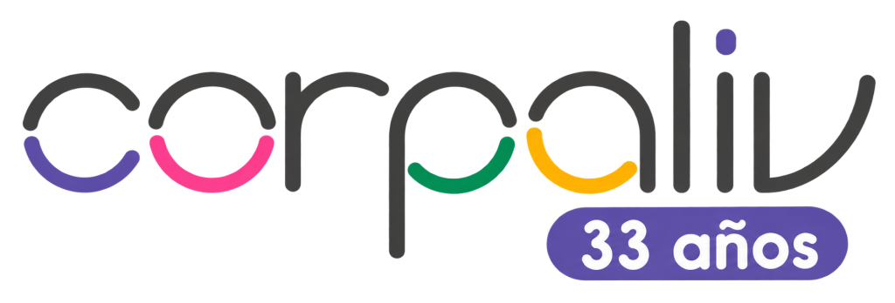
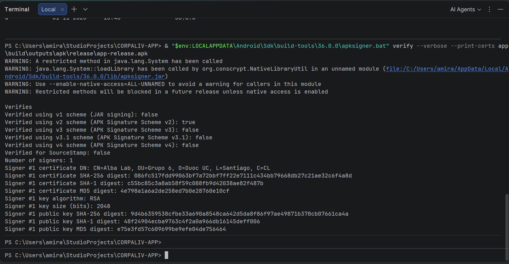
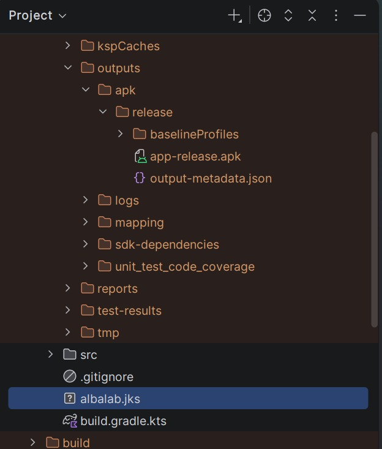

<p align="center">
  
</p>

<h1 align="center">Alba Lab</h1>

<p align="center">
  Aplicación móvil para conectar a personas y empresas con la misión de <b>CORPALIV</b> y su red sociolaboral <b>Alba Lab</b>.
</p>

<p align="center">
  
  
  
  
  
</p>

---

## 📑 Índice

1. [Descripción del proyecto](#-descripción-del-proyecto)
2. [Integrantes](#-integrantes)
3. [Funcionalidades](#-funcionalidades)
4. [Endpoints utilizados](#-endpoints-utilizados)
5. [Pasos para ejecutar](#️-pasos-para-ejecutar)
6. [APK firmado y llave .jks](#-apk-firmado-y-llave-jks)
7. [Pruebas unitarias y cobertura](#-pruebas-unitarias-y-cobertura)
8. [Arquitectura](#-arquitectura)
9. [Trabajo colaborativo](#-trabajo-colaborativo)

---

## 📖 Descripción del proyecto

**CORPALIV** es una corporación sin fines de lucro que trabaja por el desarrollo e inclusión de personas con discapacidad múltiple, a través de la **Escuela Especial Jan Van Dijk** y su **Red Sociolaboral Alba Lab**.

Hoy falta un canal claro y centralizado para comunicar su impacto social, lo que dificulta que el interés de un potencial colaborador se convierta en una acción real (donaciones, voluntariado, alianzas, compra de productos o capacitaciones).

**Alba Lab** es una app Android que resuelve esto:

- 💜 Da a conocer el propósito, programas e historia de la corporación.
- 🛍️ Muestra el catálogo de productos hechos por jóvenes y adultos de Alba Lab.
- 🤝 Permite a personas y empresas enviar una solicitud de colaboración, que se guarda en un microservicio propio.
- 👤 Permite a los socios crear su cuenta y gestionar su perfil y sus solicitudes.

> Proyecto desarrollado para la **Evaluación Parcial 4** de **DSY1105 – Desarrollo de Aplicaciones Móviles** (Duoc UC), como continuación de la Evaluación Parcial 2. Todos los datos son ficticios.

---

## 👩‍💻 Integrantes

**Grupo 6**

| Integrante | GitHub | Responsabilidades |
|---|---|---|
| Amira Rice | [@Amirosaa](https://github.com/Amirosaa) | Base de Retrofit, microservicio **ms-socios**, Perfil (CRUD de socios), tests de `LoginViewModel` y `SocioRepository`, cobertura y APK firmado |
| Daniela Beltrán | [@Dabelca](https://github.com/Dabelca) | Microservicio **ms-solicitudes**, Colaborar y Mis solicitudes (CRUD de solicitudes), API externa **mindicador.cl**, tests de `ContactoViewModel`, `TiendaViewModel`, `ContactoRepository` e `IndicadoresRepository`, Trello y README |

---

## ✨ Funcionalidades

La app se navega con una **barra inferior** de 5 secciones.

### 🏠 Inicio
- Propósito de la corporación y botón **"Quiero ayudar"** que lleva a Colaborar.

### ℹ️ Nosotros
- Misión, visión, valores, Escuela Jan Van Dijk, programas de inclusión laboral e historia, en tarjetas que se **expanden con animación**.

### 🛍️ Tienda
- Catálogo con imagen, descripción y precio, y **filtro por tipo**.
- 🔊 **Lectura en voz alta** de cada producto (Text-to-Speech) y 📤 **compartir** un producto.

### ❤️ Colaborar
- Información para donar como **persona** o **empresa**.
- 💱 **Valores de la UF y la UTM del día** (API externa mindicador.cl) en la sección de empresas, como referencia para los beneficios de las leyes de donación.
- **Formulario de colaboración** validado por campo (ícono y mensaje de error) que se envía al microservicio **ms-solicitudes**.
- Mensaje de error si el microservicio no responde.

### 👤 Perfil
- **Registro, inicio de sesión, edición de perfil y eliminación de cuenta** contra el microservicio **ms-socios**.
- **Mis solicitudes**: lista las solicitudes del socio desde **ms-solicitudes**, con opción de **editar** el mensaje y **eliminar** (con confirmación).
- 📷 Foto de perfil desde la **cámara** (con permiso en tiempo de ejecución) o la **galería**.

### 📱 Recursos nativos

| Recurso | Dónde | Detalle |
|---|---|---|
| 📷 Cámara | Perfil | `TakePicture()` + permiso `CAMERA` en tiempo de ejecución + `FileProvider` |
| 🖼️ Galería | Perfil | `GetContent()` |
| 🔊 Text-to-Speech | Tienda | Lee el nombre, descripción y precio del producto |
| 📤 Compartir | Tienda | `Intent.ACTION_SEND` |

---

## 🔌 Endpoints utilizados

Repositorio de los microservicios: **CORPALIV-BACKEND**(https://github.com/Amirosaa/CORPALIV-BACKEND.git)

### Microservicio ms-socios — puerto 8080

Spring Boot + JPA + MySQL. Base de datos: `corpaliv_socios`. Entidad `Socio`: id, nombre, correo, clave.

| Método | Endpoint | Descripción |
|---|---|---|
| POST | `/api/socios` | Registra un socio |
| POST | `/api/socios/login` | Inicia sesión (401 si las credenciales son incorrectas) |
| GET | `/api/socios/{id}` | Obtiene un socio por id |
| PUT | `/api/socios/{id}` | Edita el perfil del socio |
| DELETE | `/api/socios/{id}` | Elimina la cuenta |

### Microservicio ms-solicitudes — puerto 8081

Spring Boot + JPA + MySQL. Base de datos: `corpaliv_solicitudes`. Entidad `Solicitud`: id, nombre, correo, tipoColaborador, formaColaboracion, mensaje, estado.

| Método | Endpoint | Descripción |
|---|---|---|
| POST | `/api/solicitudes` | Crea una solicitud de colaboración (queda con estado "Enviada") |
| GET | `/api/solicitudes?correo={correo}` | Lista las solicitudes de un correo ("Mis solicitudes") |
| GET | `/api/solicitudes/{id}` | Obtiene una solicitud por id (404 si no existe) |
| PUT | `/api/solicitudes/{id}` | Actualiza una solicitud |
| DELETE | `/api/solicitudes/{id}` | Elimina una solicitud (204 No Content) |

### API externa: mindicador.cl

| Método | Endpoint | Uso en la app |
|---|---|---|
| GET | `https://mindicador.cl/api` | Muestra la UF y la UTM del día en Colaborar → Empresas |

Se consume con Retrofit en un repositorio propio (`IndicadoresRepository` + `IndicadoresInstance`), separado de los microservicios. Si no hay conexión, la app muestra un aviso con opción de reintentar.

### ¿Cómo se conecta la app?

Cada servicio tiene su propia instancia de Retrofit:

| Instancia | URL base | Servicio |
|---|---|---|
| `RetrofitInstance` | `http://10.0.2.2:8080/` | ms-socios |
| `SolicitudInstance` | `http://10.0.2.2:8081/` | ms-solicitudes |
| `IndicadoresInstance` | `https://mindicador.cl/` | API externa |

`10.0.2.2` es la dirección con la que el **emulador** llega al computador. El manifiesto incluye el permiso `INTERNET` y `usesCleartextTraffic="true"` para permitir HTTP hacia los microservicios locales.

---

## ▶️ Pasos para ejecutar

### Requisitos
- Android Studio (versión reciente) y emulador con **Android 7.0 (API 24)** o superior.
- IntelliJ IDEA (u otro IDE) con **Java 21**.
- **MySQL** encendido (Laragon, XAMPP o similar).

### 1. Microservicios

1. Clonar el repositorio **CORPALIV-BACKEND**.
2. Encender MySQL. Las bases `corpaliv_socios` y `corpaliv_solicitudes` se crean solas al arrancar (`createDatabaseIfNotExist=true`).
3. Abrir **cada microservicio por separado** (`ms-socios` y `ms-solicitudes`) y ejecutar su clase `...Application`.
4. Comprobar en la consola: `Tomcat started on port 8080` (ms-socios) y `port 8081` (ms-solicitudes).

> 🔑 Ambos usan el usuario `root` sin contraseña. Si tu MySQL tiene contraseña: en ms-solicitudes define la variable de entorno `DB_PASSWORD`, y en ms-socios `SPRING_DATASOURCE_PASSWORD`, en la configuración de ejecución del IDE.

### 2. App móvil

1. Clonar el repositorio:
   ```bash
   git clone https://github.com/Dabelca/CORPALIV-APP.git
   ```
2. Abrir la carpeta en Android Studio y esperar el **Gradle Sync** 🐘.
3. Ejecutar en un emulador con ▶️ *Run 'app'*.

### 3. Probar el flujo completo

1. **Perfil** → crear una cuenta e iniciar sesión.
2. **Colaborar** → enviar una solicitud **con el mismo correo** de la cuenta.
3. **Perfil** → *Mis solicitudes*: aparece la solicitud; se puede **editar** y **eliminar**.
4. **Colaborar** → **Empresas**: ver la UF y la UTM del día.

---

## 🔏 APK firmado y llave .jks

- **APK firmado:** `app/release/app-release.apk`
- **Llave:** `app/albalab.jks` (alias `albalab`)
- **Configuración:** bloque `signingConfigs` en `app/build.gradle.kts`, aplicado al build `release` (con R8 activado).

### Cómo se generó
1. Se creó la llave `albalab.jks` con `keytool`, con su alias y contraseña.
2. Se agregó `signingConfigs { create("release") { ... } }` en `app/build.gradle.kts` y se asignó al `buildType` `release`.
3. Se compiló el release firmado con `.\gradlew assembleRelease`.
4. Se verificó la firma con `apksigner verify --print-certs` y se probó el APK instalado.

**Verificación de la firma del APK:**



**APK generado y llave .jks en el proyecto:**



---

## 🧪 Pruebas unitarias y cobertura

Herramientas: **Kotest** (`StringSpec`, `shouldBe`) + **MockK** + **kotlinx-coroutines-test**. Se mockean las APIs de Retrofit y los repositorios, para probar la lógica sin depender de los microservicios ni de internet.

| Clase probada | Qué se valida |
|---|---|
| `LoginViewModel` | Login correcto e incorrecto, validaciones, registro, edición y eliminación de cuenta, carga de solicitudes |
| `SocioRepository` | Llamadas a ms-socios (login, registro, actualizar, eliminar) |
| `ContactoViewModel` | Validaciones del formulario, envío exitoso, error del microservicio y carga de UF/UTM |
| `ContactoRepository` | Crear, listar por correo, actualizar y eliminar solicitudes |
| `IndicadoresRepository` | Obtener UF y UTM de la API externa |
| `TiendaViewModel` | Catálogo inicial, tipos sin repetir y filtro por tipo |

Ejecutar las pruebas:

```bash
./gradlew testDebugUnitTest
```

Generar el reporte de cobertura (`app/build/reports/coverage/test/debug/index.html`):

```bash
./gradlew createDebugUnitTestCoverageReport
```

<!--  -->

---

## 🧱 Arquitectura

**App móvil — MVVM.** La lógica y validaciones están en los ViewModels; los repositorios se reciben por constructor para poder reemplazarlos por mocks en los tests.

```
app/src/main/java/com/duoc/albalab/
├── data/remote/     # Interfaces e instancias de Retrofit (microservicios y API externa)
├── model/           # Modelos de datos y estados de la UI
├── repository/      # Intermediarios entre ViewModel y servicios
├── viewmodel/       # Lógica, estado (StateFlow) y validaciones
├── navigation/      # Rutas y barra de navegación
└── ui/              # Pantallas (inicio, nosotros, tienda, colaborar, perfil) y tema
```

**Microservicios — capas.** Cada uno es un proyecto Spring Boot independiente, con su propio puerto y base de datos.

```
com.duoc.<microservicio>/
├── model/        # Entidad JPA (@Entity)
├── repository/   # JpaRepository (consultas)
└── controller/   # @RestController con los endpoints
```

---

## 🤝 Trabajo colaborativo

- Cada funcionalidad se desarrolla en su propia rama (`feature/...`, `fix/...`, `test/...`) y se integra a `main` mediante **Pull Requests**.
- La planificación se realiza en **Trello**, con las listas *Pendiente*, *En progreso* y *Hecho*, y una tarjeta por tarea asignada a cada integrante.


<!--  -->

---

<p align="center">
  Hecho con 💜 por el Grupo 6 · DSY1105 · Duoc UC
</p>
